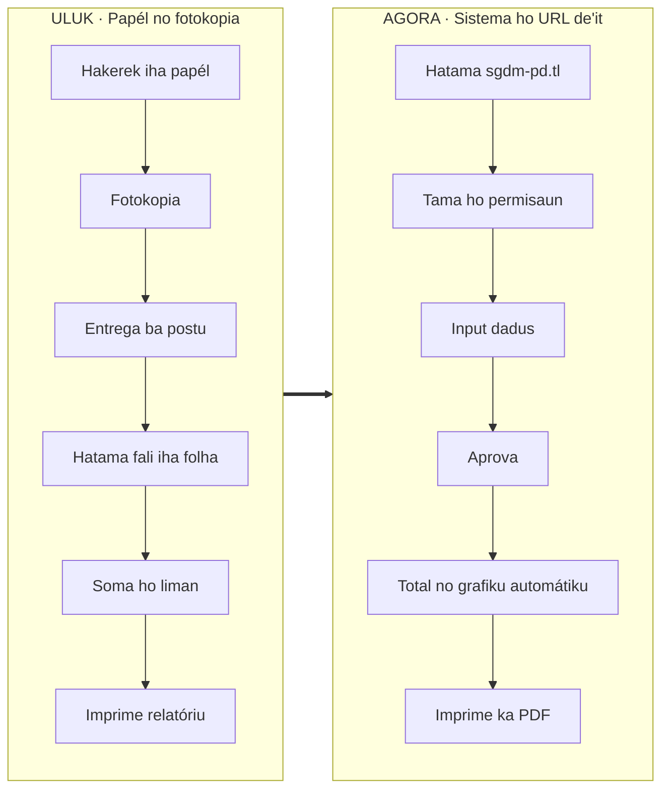
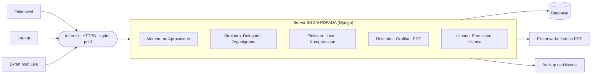
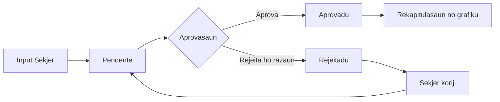
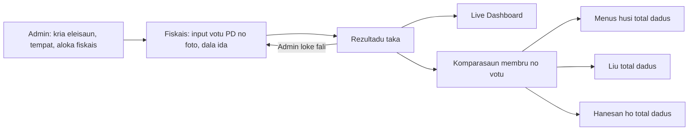
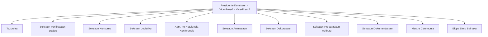

# Transformasaun SGDM-PDPADA: husi papél no fotokopia ba sistema ho URL de'it

Dokumentu ne'e rejistu mudansa husi dadus iha papél (print, fotokopia) ba sistema ida ne'ebé ema hotu uza liu husi **enderesu web (URL)** de'it. Planu enderesu ofisiál: **`sgdm-pd.tl`** (planu, seidauk konfirma rejistu domíniu).

Atualiza: 14 Novembru 2026.

## 1. Situasaun uluk

- Dadus membru, lista delegadu, organigrama no rekapitulasaun hakerek iha papél, fotokopia no imprime dala barak.
- Papél barak liu, susar atu buka, dala ruma lakon ka dupla.
- Total suku, aldeia no organizasaun soma ho liman; bele sala no tempu naruk.
- Susar hatene se mak muda dadus no bainhira.

## 2. Mudansa prinsipál

| Uluk (papél) | Agora (sistema) |
|---|---|
| Hakerek dadus iha papél | Input iha sistema (Sekjer Suku, Aldeia, Organizasaun) |
| Fotokopia no entrega ba postu | Dadus tama kedas iha sistema; Presidente/Coordenador aprova |
| Hatama fali iha folha/Excel | Dadus iha database ida; la presiza hatama fali |
| Soma total ho liman | Total, grafiku no komparasaun sai automátiku |
| Imprime lista no organigrama | Imprime ka download PDF husi sistema |
| La iha rejistu mudansa | Historia rejistu kria, edita, aprova, aloka, ekspor |
| Eleisaun: rezultadu iha papél | Fiskais input votu PD no foto; Live Dashboard iha ekran boot |

## 3. Oinsá uza: URL de'it

1. Loke browser iha telemovel, laptop ka ekran boot.
2. Hatama `sgdm-pd.tl` (ho HTTPS).
3. Tama (login) ho username no password.
4. Hetan Varanda tuir **permisaun** (postu, suku, aldeia, organizasaun, fiskais, admin).

La presiza instala aplikasaun. Live Dashboard uza Full Screen no Wake Lock atu ekran la mate.

## 4. Diagrama arkitetura

## 5. Permisaun no regra

| Permisaun | Bele hare | Bele halo |
|---|---|---|
| Presidente Postu | Postu tomak | Aprova, aloka pozisaun, organigrama, hamoos membru, hare Historia |
| Coordenador Postu | Postu tomak | Aprova, ekspor CSV, delegadu, hamoos membru, hare Historia |
| Sekretariu Postu | Rekapitulasaun, grafiku no lista delegadu | Hare no imprime de'it; laiha asesu ba lista membru |
| Coordenador / Sekjer Suku | Nia suku de'it | Sekjer: input membru; delegadu suku rasik |
| Coordenador / Sekjer Aldeia | Nia aldeia de'it | Sekjer: input membru |
| Koord. / Sekr. Organizasaun | Membru organizasaun (OJD, OPD, MPD) | Sekr.: input membru |
| Fiskais Partidu | Nia tempat votasaun de'it | Input votu PD no foto dala ida de'it; taka hafoin submete |
| Admin | La hare dadus membru | Uzuáriu, dadus master, eleisaun, tempat, fiskais, Live, loke fali rezultadu |

Regra jerál: server verifika permisaun kada pájina; suku ida la hare suku seluk.

## 6. Fluxu dadus membru

## 7. Fluxu eleisaun

## 8. Organigrama komisaun

## 9. Planu enderesu `sgdm-pd.tl`

Estadu: **planu**. Enderesu temporáriu ba teste no apresentasaun: `caro.pythonanywhere.com`.

| Pasu | Saida mak presiza |
|---|---|
| 1. Rejistu domíniu | Rejistu `sgdm-pd.tl` ho rejistradór domíniu .tl (konfirma prosesu no kustu) |
| 2. Liga ba server | DNS hatudu domíniu ba server sistema |
| 3. HTTPS | Sertifikadu seguru (koneksaun ho kadeadu) |
| 4. Konfigura sistema | `DJANGO_ALLOWED_HOSTS=sgdm-pd.tl,www.sgdm-pd.tl`, `DJANGO_CSRF_TRUSTED_ORIGINS=https://sgdm-pd.tl,https://www.sgdm-pd.tl`, `DJANGO_HSTS_SECONDS` (hafoin HTTPS estável) |
| 5. Teste no treinamentu | Ho Sekjer Suku, Aldeia, Organizasaun no Fiskais |
| 6. Loke ba uzuáriu | Fahe liña `sgdm-pd.tl` ba uzuáriu hotu |

Nota: domíniu personalizadu iha PythonAnywhere presiza planu selu; konfirma molok lansa.

## 10. Glosáriu termu

| Termu ne'ebé la uza | Termu Tetun INL ne'ebé uza |
|---|---|
| wilayah | postu ka suku |
| peran | permisaun (ka regra) |
| sebelumnya / depois | uluk / hafoin |

## 11. Pasu tuir mai

- Rejistu domíniu no konfigura HTTPS.
- Importa dadus membru ne'ebé iha ona husi papél no Excel.
- Treinamentu ba Sekjer Suku, Aldeia, Organizasaun no Fiskais.
- Hatama responsavel organigrama no delegadu suku hotu.
- Backup regulár no revee seguransa kada tinan.
